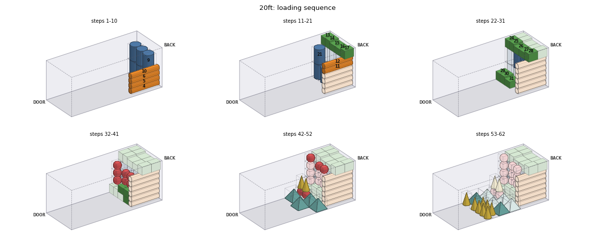
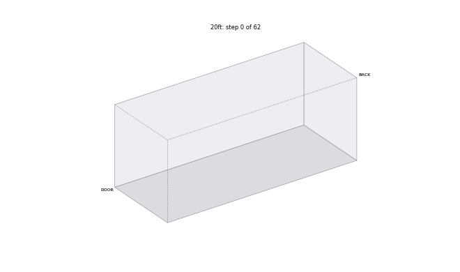
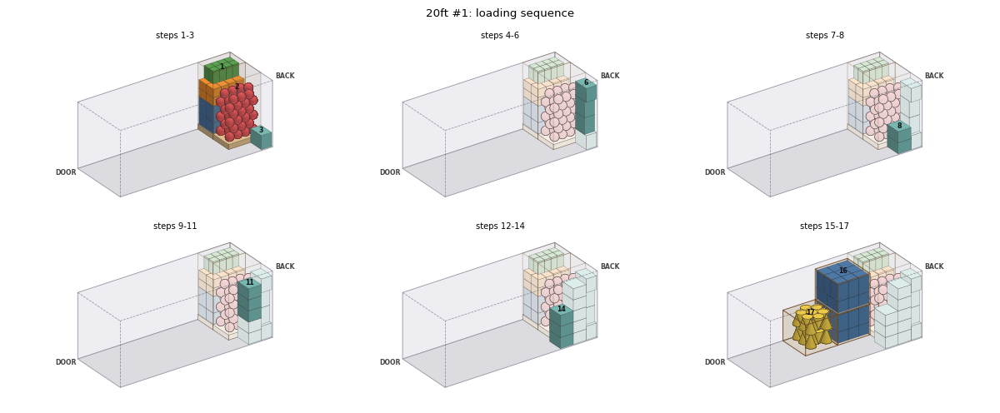

# 3D Bin Packer CPP

Fast 3D bin packing for the container loading problem (C++17 core, Python bindings + tools).

- Realistic loads: every item rests on the floor or on other items (no floating boxes).
- You choose which side is filled first: back (wall building), bottom (layers) or left.
- Per-item handling rules: *this side up*, *floor only*, *do not stack / top only*,
  max stacking weight / layers / height.
- Shaped goods (spheres, pyramids, cones, cylinders): drawn as what they really are.
- **Crates / trunks** with outer and inner dimensions: filled with goods (one shape and size, or boxes
  of any sizes), then loaded with the rest. Items can be marked as crate-only.
- Bulk shipments of one shaped product: loose in the densest pattern for the shape (close-packed
  balls, alternating tip-up / tip-down cones, ...), one product per container.
- A **feasible loading sequence**: a plan a loader can follow step by step from the door
  (or top / side), checked and guaranteed.
- **Overflow and profit:** when not everything fits, the packer maximises volume, weight,
  revenue or item count. It also handles priorities and consignments that must ship complete,
  and reports why each item was left out.
- **Fleet planning:** give it the container / truck / van types you can book (limited or unlimited,
  each with a cost) and it picks the cheapest, or smallest, set that carries the cargo. Or,
  with `Objective.PROFIT`, only the containers that pay for themselves.
- Freight tariffs (chargeable weight, W/M, loading metres, LTL classes, ...) to price items.
- Loading plans (table / CSV), an independent plan validator, and pictures / animations
  of the loading sequence, for one container or a whole fleet.

## Build

```bash
pip install ".[render]"              # engine + Python tools (+ matplotlib for pictures)
# or, for development:
pip install pybind11 setuptools numpy matplotlib
python setup.py build_ext --inplace  # builds src/pybinding*.so
cd src && python -m unittest test test_binpack test_constraints
```

Set `BINPACK_NATIVE=1` when building to compile for your CPU's full SIMD width
(`-march=native`). Only use it for local builds, because the binary won't be portable.

C++ tests:

```bash
g++ -std=c++17 -O3 -Iinclude -Isrc main.cpp src/item.cpp src/box.cpp src/bin.cpp src/packer.cpp \
    src/utils.cpp src/log.cpp src/packing_engine.cpp src/loading_sequence.cpp \
    src/bin_planner.cpp src/fleet_planner.cpp -o main_test && ./main_test
```

### Testing: constraint guards

There are many loading rules, and a new feature can easily break one of them. `src/test_constraints.py`
guards them (a few seconds; run it after every change):

```bash
cd src && python -m unittest test_constraints -v
```

- **`TestPlansAreValid`** runs every feature on realistic cargo and requires `bp.validate(...) == []`.
  `validate` is an independent audit of every rule, and it shares no code with the packers. The
  features are: handling rules for every fill order and access side, fleet planning, shaped goods,
  bulk loads, crates and loading crates.
- **`TestValidatorCatches`** breaks a valid plan one rule at a time and requires the matching check to
  fire: bounds, overlap, support, rotation, upright, floor only, no stacking, stacking limits, loading
  order, weight, consignments, fleet, count, crate-only items, shape overlap, tip-down pieces, one
  product per crate or container, crate size, weight and stock, and loading-crate rules. Without this
  half, a check that silently stopped working would let every plan pass.

When you add a rule, add its check to `binpack/validate.py`, a scenario that uses it to
`TestPlansAreValid`, and a mutation that breaks it to `TestValidatorCatches`.

## Quick start

```python
import binpack as bp

packer = bp.Packer(fill_order=bp.FillOrder.BACK_BOTTOM_LEFT,    # wall building, nose -> door
                   loading_access=bp.LoadingAccess.DOOR)       # sequence loadable through the door
packer.add_bin(bp.Bin("40ft HC", 2350, 2690, 12030, max_weight=26500))

for i in range(300):
    packer.add_item(bp.Item(f"carton {i}", 600, 400, 500, weight=12))
for i in range(10):
    packer.add_item(bp.Item(f"fridge {i}", 700, 1800, 700, weight=80,
                            upright=True, bottom_load_only=True))
for i in range(20):
    packer.add_item(bp.Item(f"glassware {i}", 800, 300, 600, weight=15,
                            disable_stacking=True))

packer.pack()

print(bp.format_plan(packer))          # step-by-step loading instructions + what was left out
assert bp.validate(packer) == []       # independent check of every rule and of the sequence
bp.render_loading_steps(packer.get_bins()[0]).savefig("loading.png")
```

## Examples with pictures

Both scripts validate their plan and write `loading.png` (loading-step snapshots) and `loading.gif`
(the loading sequence, animated) to the folder given:

```bash
python examples/shaped_goods.py docs/shapes
python examples/crate_loading.py docs/crates
```

### Shaped goods

Spheres, cones, cylinders and pyramids loaded with cartons. Each is packed as its box and drawn as
its real shape. Nothing may go on the tip of a cone or pyramid (`disable_stacking`). Pipes may lie
down, and drums stand upright.

```python
import binpack as bp

packer = bp.Packer(fill_order=bp.FillOrder.BACK_BOTTOM_LEFT, loading_access=bp.LoadingAccess.DOOR)
packer.add_bin(bp.Bin("20ft", 2350, 2390, 5900, max_weight=28000))
for i in range(16):
    packer.add_item(bp.Item(f"carton {i}", 600, 400, 500, weight=12))
for i in range(12):
    packer.add_item(bp.Item(f"drum {i}", 600, 900, 600, weight=60, shape="cylinder", upright=True))
for i in range(6):
    packer.add_item(bp.Item(f"pipe {i}", 300, 1800, 300, weight=25, shape="cylinder"))   # may lie down
for i in range(12):
    packer.add_item(bp.Item(f"ball {i}", 450, 450, 450, weight=3, shape="sphere"))
for i in range(10):   # nothing is stacked on a tip
    packer.add_item(bp.Item(f"traffic cone {i}", 400, 700, 400, weight=2, shape="cone", upright=True,
                            disable_stacking=True))
for i in range(6):
    packer.add_item(bp.Item(f"display {i}", 700, 600, 700, weight=8, shape="pyramid", upright=True,
                            disable_stacking=True))
packer.pack()

assert bp.validate(packer) == []
bin_ = packer.get_bins()[0]
bp.render_loading_steps(bin_, panels=6).savefig("loading.png", dpi=80)
bp.animate_loading(bin_, "loading.gif", frames=30, fps=5, dpi=60)
```





### Crate loading

This example uses closed crates, trunks in limited stock, and wheeled loading crates (open to the
ceiling). Crate-only goods always go in a crate. The optional cones are crated because that takes
less space than loading them loose, and the cartons travel loose.

```python
import binpack as bp

packer = bp.Packer()
packer.add_bin_type(bp.Bin("20ft", 2350, 2390, 5900, max_weight=28000, cost=1800))
for i in range(60):   # must travel in a crate: one shape and size per crate, densest pattern
    packer.add_item(bp.Item(f"ball {i}", 300, 300, 300, shape="sphere", weight=2, crate_required=True))
for i in range(40):   # boxes of any sizes share a crate
    packer.add_item(bp.Item(f"tote {i}", 600, 400, 400, weight=6, crate_required=True))
for i in range(16):
    packer.add_item(bp.Item(f"glass {i}", 400, 300, 300, weight=8, crate_required=True))
for i in range(8):
    packer.add_item(bp.Item(f"vase {i}", 250, 450, 250, weight=4, crate_required=True, upright=True))
for i in range(30):   # optional: crated only if that takes less space than loose
    packer.add_item(bp.Item(f"cone {i}", 350, 500, 350, shape="cone", weight=1))
for i in range(12):   # loose
    packer.add_item(bp.Item(f"carton {i}", 600, 400, 500, weight=12))

crates = [
    bp.CrateType("Crate L", outer=(1250, 1100, 1250), inner=(1200, 1000, 1200), tare_weight=40, max_weight=800),
    bp.CrateType("Trunk", outer=(900, 700, 650), inner=(860, 640, 610), tare_weight=15, max_weight=300, count=4),
    bp.LoadingCrate("Dolly", outer=(1250, 850), inner=(1200, 800), base_height=180,   # wheels, no walls
                    tare_weight=35, max_weight=900, count=2),
]
plan = bp.pack_with_crates(packer, crates)

assert bp.validate(plan) == []        # containers, crates and their contents
print(bp.format_plan(plan))           # loading steps + what each crate holds
bin_ = plan.get_bins()[0]
bp.render_loading_steps(bin_, panels=6).savefig("loading.png", dpi=80)
bp.animate_loading(bin_, "loading.gif", frames=30, fps=4, dpi=60)
```




`binpack` re-exports everything from the compiled `pybinding` module, which can still be
imported directly.

## Coordinates

The origin `(0, 0, 0)` is the **back-bottom-left** corner of the bin.

| axis | dimension | grows towards | side at 0 |
|------|-----------|---------------|-----------|
| x    | width     | right         | left      |
| y    | height    | up (gravity is -y) | bottom |
| z    | depth     | the door      | back (container nose) |

`item.get_position()` is the item's back-bottom-left corner. `item.get_dimension()` is its
placed size along (x, y, z), with the chosen rotation already applied.

## Choosing which side to fill first

`fill_order` says which side is filled first, second and third. The packer places each item at
the first feasible position in that order.

| `FillOrder`        | behaviour |
|--------------------|-----------|
| `BACK_BOTTOM_LEFT` (default) | **Back first.** Builds walls from the nose towards the door, which is how containers and trucks are loaded. A part load leaves the free space at the door. |
| `BOTTOM_BACK_LEFT` | **Bottom first.** Covers the whole floor, then builds the next layer. Suits pallets, top-loaded boxes and low centres of gravity. |
| `LEFT_BOTTOM_BACK` | **Left first.** Fills one side wall at a time (side-loading). |
| `BOTTOM_LEFT_BACK`, `BACK_LEFT_BOTTOM`, `LEFT_BACK_BOTTOM` | the remaining priorities |

## Item handling rules

All of these are keyword arguments of `Item(...)` and read/write properties. Positional
arguments keep their old order.

| rule | argument | meaning |
|------|----------|---------|
| This side up | `upright=True` | The item only turns around the vertical axis: its `h` stays vertical (`UPRIGHT_ROTATIONS` = `whd`, `dhw`). |
| Allowed rotations | `allowed_rotations=[...]` | Any subset of `ALL_ROTATIONS`. `[RotationType.whd]` fixes the orientation. Combined with `upright`, both apply. |
| Floor only | `bottom_load_only=True` | The item must stand on the container floor. These items are packed first so they get floor space. |
| Top only / do not stack | `disable_stacking=True` | Nothing may be placed anywhere above the item. See below. |
| Max weight on top | `stuffing_max_weight=kg` | Total weight resting above the item. An item above counts in proportion to how much of its base overlaps. |
| Max layers on top | `stuffing_layers=n` | At most `n` distinct levels of items above the item. |
| Max stacking height | `stuffing_height=h` | Nothing above the item may reach higher than `h` above its top. |
| Revenue | `value=...` | What shipping the item earns (see *Overflow and profit*). |
| Priority | `priority=n` | Higher priorities are loaded before any lower one. |
| Consignment | `group="..."` | All items of a group go into the same bin, or none of them do. |
| Shape | `shape="sphere"` | What the item really is. Only changes the pictures and reports, see *Shaped items*. |
| Crate only | `crate_required=True` | Travels only inside a crate (see *Crates*). `Packer.pack()` never loads it loose. |

**Top-only items.** With `non_stackable_on_top=True` (the default), non-stackable items are packed
after everything else and placed as high as possible, so they end up on top of the load. If there is
no headroom left on top (e.g. back-first walls built to the ceiling), they still get a spot with nothing
above them, usually towards the door. Set `non_stackable_on_top=False` to pack them by size with the
other items instead. `item.set_height_constraint(True, value)` also marks an item as non-stackable.

## Shaped items

Spheres, pyramids, cones and cylinders are packed as their `w x h x d` box: each one ships in a
thin carton of that size (negligible wall thickness), and the packer loads the cartons. The shape
doesn't change the packing at all; a sphere is placed exactly where a box of the same size would go.
The pictures show the real shape inside a faint outline of its carton, and the loading plan names it.

```python
packer.add_item(bp.Item("ball", 500, 500, 500, shape="sphere"))
packer.add_item(bp.Item("traffic cone", 400, 700, 400, shape=bp.Shape.CONE, upright=True))
packer.add_item(bp.Item("drum", 600, 900, 600, shape="cylinder", upright=True))
packer.add_item(bp.Item("pipe", 300, 1200, 300, shape="cylinder"))   # may be laid on its side
packer.add_item(bp.Item("display", 700, 600, 700, shape="pyramid"))
```

| `Shape` | drawn as |
|---------|----------|
| `BOX` (default) | the box |
| `SPHERE` | a ball filling the box (an ellipsoid if the sides differ) |
| `CYLINDER` | standing on its `w x d` base, axis along `h` |
| `CONE` | round `w x d` base at the bottom, tip at the top (along `h`) |
| `PYRAMID` | rectangular `w x d` base at the bottom, apex at the top (along `h`) |

`shape` accepts a `bp.Shape` or its name (any case). The shape's height is the item's `h`, so the
rotation the packer picks turns the shape too. With all rotations allowed, a cylinder or cone can end
up on its side. Use `upright=True` to keep it standing. Round shapes fill the `w x d` footprint, so give
them `w == d` for a circular cross-section.

## Crates and trunks

A crate (or trunk, or small container) is a box with **outer** dimensions, the space it takes in the
container, and **inner** dimensions, the space for goods. Goods go in crates, and crates are loaded into
the containers like any other box, together with loose goods. One crate holds one kind of goods:

- shaped goods of **one shape and one size** (sphere, pyramid, cone, cylinder), in the densest
  pattern for the shape (see *Bulk loads*), filled from the bottom, or
- **boxes of any sizes**, packed like a small container loaded from the top. All item rules
  apply inside.

Crates never mix consignments (`group`).

```python
packer = bp.Packer()                                  # containers and settings as usual
packer.add_bin_type(bp.Bin("20ft", 2350, 2390, 5900, max_weight=28000, cost=1800))
packer.add_item(bp.Item("ball", 300, 300, 300, shape="sphere", weight=2, crate_required=True))
packer.add_item(bp.Item("glass", 400, 300, 300, weight=8, crate_required=True))
packer.add_item(bp.Item("carton", 600, 400, 500, weight=12))              # may go in a crate, or loose

crates = [bp.CrateType("Crate L", outer=(1250, 1100, 1250), inner=(1200, 1000, 1200),
                       tare_weight=40, max_weight=800),
          bp.CrateType("Trunk", outer=(900, 700, 650), inner=(860, 640, 610),
                       tare_weight=15, max_weight=300, count=3)]       # only 3 trunks available
plan = bp.pack_with_crates(packer, crates)

print(bp.format_plan(plan))       # loading plan (crates are steps) + what each crate holds
bp.validate(plan)                 # [] - also checks the crates (one kind, fit, weight, stock)
bp.crate_manifest(plan)           # one row per item in a crate: crate, container, step, position
bp.render_packer(plan)            # crates drawn see-through, with their contents
```

- `CrateType(name, outer, inner, tare_weight=0, max_weight=0, cost=0, count=None, upright=True,
  stackable=True, max_load=0, inner_offset=None)`. `max_weight` is the most weight of goods it
  takes, and `count=None` means as many as needed. `upright`, `stackable` and `max_load` are the
  crate's own handling rules in the container. The inner space is centred unless `inner_offset` is given.
- **Crate-only items** (`crate_required=True`) always go in a crate. If no crate can take one (too
  large or heavy, or no crate left in stock), it is reported with that reason and never loaded loose.
- **Other items** travel loose, unless crating takes less container space:
  - Shaped goods are crated when the crates are smaller than their boxes loose. Crates are used in
    whole crates' worth; the rest stays loose.
  - Any item also rides in the free space of a crate that goes anyway.
  - `crate_optional=False` turns this off.
- **Choosing crates:** per kind of goods, the cheapest crates (by `cost`, or by outer volume when
  crates cost nothing) that hold the goods. Crates in limited stock go to the biggest kinds first.
- **Loading:** a copy of `packer` (its containers, container types and settings) loads crates and
  loose items. Fleet planning, handling rules and the loading sequence all apply. A crate weighs
  its tare plus its goods. A crate holding *this side up* goods is kept upright. `packer` itself is
  left unchanged.
- The plan reads like a packed `Packer`:
  - `get_bins()`, `get_items()` and `get_unfit_items()` work as usual.
  - A crate is an item with `crate_index >= 0`, and `plan.crate_of(item)` gives its `Crate`.
  - Each `Crate` has `contents` (in inner coordinates), `pattern`, `fill` and `weight`.
  - `plan.unloaded_goods()` lists every item that doesn't ship, including the contents of crates
    that didn't fit.

### Loading crates (wheeled bases, open to the ceiling)

A loading crate is a base on wheels, with no walls and no lid. Its footprint is a little bigger than the
space for goods, and `base_height` runs from the ground to the floor the goods stand on. Goods stack
up to the container ceiling, so the crate takes the **full container height**:

- it stands on the container floor (`floor_only`);
- nothing is loaded on top of it, not even another loading crate (`stackable=False`);
- it is never tipped (`upright`).

```python
dolly = bp.LoadingCrate("Dolly", outer=(1250, 850), inner=(1200, 800),  # footprints (width, depth)
                        base_height=180, tare_weight=35, max_weight=900)
plan = bp.pack_with_crates(packer, [dolly, trunk])
```

- The column height is the height of the lowest container the packer can use (its bins and container
  types), so a filled loading crate fits any of them. Goods get that height minus `base_height`. In a
  taller container the space above the crate stays empty. Pass `height=` to fix it instead.
- `inner_offset=(x, z)` places the goods' footprint on the base (centred by default).
- `LoadingCrate(...)` returns a `CrateType` with `open_top=True`. All crate rules apply: one kind of
  goods per crate, crate stock and cost.
- Pictures draw the base as a wooden slab and the open column as a faint outline up to the ceiling.

## Bulk loads of shaped goods

When a whole shipment is one shaped product in one size (say 5,000 identical balls), the pieces go
loose into the container, held by clips, instead of one carton each. `pack_bulk` places them in
the densest standard pattern for the shape, books the containers and leaves the rest of the last
one empty. Only one product goes in a container. Mixing shapes or sizes is not supported.

```python
ball = bp.Item("ball", 400, 400, 400, shape="sphere", weight=2)
hc40 = bp.Bin("40ft HC", 2350, 2690, 12030, max_weight=26500, cost=3000)
ft20 = bp.Bin("20ft", 2350, 2390, 5900, max_weight=28000, cost=1800)
plan = bp.pack_bulk(ball, 5000, [hc40, ft20])
print(bp.format_bulk(plan))      # per container type: pieces per container, pattern, gain over cartons
bp.render_packer(plan)           # every picture / animation function takes a bulk plan
bp.bulk_to_csv(plan, "bulk.csv") # every piece: container, step, position, rotation, tip_down
bp.bulk_layout(ball, hc40)       # just the best arrangement for one container type
```

| shape | pattern (best count kept, every allowed orientation tried) | 40ft HC, vs one carton each |
|-------|---------|-----------|
| sphere | close packing: hexagonal layers with the next layer in the hollows, or square layers offset by half a ball (74 % of space in the limit vs 52 % for a grid) | 400 mm balls: 1,416 vs 900 (1.57x) |
| cylinder | circles in a hexagonal (or square) pattern across the section, in slabs along the axis, standing or lying | 300x1200 pipes: 700 vs 560 (1.25x) |
| cone | tip-up and tip-down cones alternating one radius apart in each row, rows √3 radii apart | 400x700 cones: 1,239 vs 540 (2.29x) |
| pyramid | tip-up and tip-down pyramids alternating half a base apart along each row (sloping faces touch) | 700x600x700: 396 vs 204 (1.94x) |

- `upright=True` keeps the height vertical and the tip up: no tip-down cones or pyramids. Upright
  cones then pack hexagonally, and upright pyramids fit no more than cartons. A lying cone may point
  either way, because that's only a turn about the vertical axis.
- Weight limits cap the pieces per container.
- Containers: for each type, either all pieces in that type, or full containers of it plus the
  remainder in one container of any type. The cheapest plan is kept, then the one with fewest
  containers, then the one with least volume. Types are unlimited.
- The loading order goes from the nose to the door, bottom to top. A part-filled container is
  filled at the back.
- Positions can be fractions (hexagonal rows are √3/2 apart). `plan.get_bins()` holds containers that
  read like `Bin`s, with pieces that read like `Item`s, plus `piece.inverted` for pieces standing on
  their tip. `container.get_utilization()` is the volume of the pieces themselves.
- The pieces don't go through `Packer`, so `validate` and the support / loading-sequence checks
  don't apply. The tests check that pieces never overlap and stay inside the container.

## Loading sequence

Each bin's `get_items()` is a **loading sequence**. The packer guarantees that a loader can
follow it from `loading_access`, because at every step the item:

1. rests only on items that are already loaded, and
2. can be moved in a straight line from the access side to its spot without passing through an
   item already loaded. For example, once the top of the front stack is loaded, nothing can go
   on top of the stack behind it.

| `LoadingAccess` | loaded from | typical use |
|-----------------|-------------|-------------|
| `DOOR` (default) | the door end (z = depth) | containers, box trucks |
| `TOP` | above | open-top containers, pallets, cartons, cranes |
| `LEFT_SIDE` / `RIGHT_SIDE` | the side at x = 0 / x = width | curtain-siders |
| `NONE` | anywhere | only "supports first" is enforced |

Among the items that can go next, the sequence takes the deepest one first, then the lowest:
nose → door for the door, bottom → top from above. So the loading face stays compact. On mixed
20ft loads, a loader reaches over at most about 0.5–1.5 m of already-loaded cargo.

In rare cases an interlocking layout has no valid order for the access side. Think of three
stacks with overhangs that each block the next. The packer then takes the last-placed item of that
cycle out (it goes to the next bin or to the overflow) and packs the bin again, so the output is
always loadable.

```python
bin_ = packer.get_bins()[0]
bin_.check_loading_sequence(bp.LoadingAccess.DOOR)   # [] = feasible, else readable problems
bin_.reorder_for_loading(bp.LoadingAccess.TOP)       # re-sequence for another access side
```

## Overflow and profit

When not everything fits:

- Bins added with `add_bin` are filled smallest first; leftovers go to the next bin. To book
  more containers automatically, use fleet planning (next section).
- `packer.get_unfit_items()` lists the leftovers. Each has an `unfit_reason`:
  `"too large for every bin"`, `"heavier than the weight limit of every bin it fits in"`,
  `"no allowed rotation ..."`, `"group could not be loaded completely into one bin"`,
  `"no container left: all available containers are in use"`,
  `"not profitable: worth less than the container it needs"`, `"weight limit reached"`,
  `"no space left"`.
- `objective` decides what the packer maximises:

| `Objective` | maximises | use when |
|-------------|-----------|----------|
| `VOLUME` (default) | cubic utilisation | FCL / own fleet: fewest containers |
| `WEIGHT` | payload | freight charged per kg, dense cargo |
| `VALUE` | sum of `Item.value` | revenue or margin, e.g. LCL consolidation |
| `COUNT` | number of items | parcels / per-piece pricing |
| `PROFIT` | sum of `Item.value` minus the cost of the containers booked | fleet planning (below) |

- `priority` always wins over the objective: a higher-priority item is never left out in favour
  of lower-priority ones (must-go cargo, contractual commitments).
- Consignments (`group`) ship complete or not at all. A groupage customer pays for a whole shipment,
  not half of one.

Behind the scenes the packer tries several strategies per bin and keeps the best for the
objective. Two of them are *select then pack*: pick the best-paying consignments by value per
unit of the scarcer resource (volume or weight), pack the pick in a space-efficient order, then
offer the rest. When a bin has a weight limit, the volume objective uses this too, so heavy cargo
can't exhaust the payload with the container half empty.

### Pricing items

`binpack.pricing` turns common freight tariffs into `Item.value`. Charges are computed per
consignment (minimums apply per shipment, as carriers invoice):

| tariff | model |
|--------|-------|
| `chargeable_weight(rate_per_kg, divisor=6000)` | air / express: max(actual kg, cm³ / divisor) (express often 5000) |
| `weight_or_measure(rate_per_revenue_ton)` | sea LCL (W/M): max(tonnes, m³) |
| `road_chargeable_weight(rate_per_kg, kg_per_m3=333)` | European road groupage (1:3) |
| `loading_meters(rate_per_ldm, trailer_width_m=2.4, kg_per_ldm=1850)` | road FTL/LTL by loading metre |
| `ltl_density_class({class: rate_per_cwt})` | US LTL, NMFC density classes |
| `per_kg`, `per_m3`, `per_piece` | simple rates |
| `minimum`, `surcharge(percent, flat, per_piece, non_stackable_percent)`, `highest`, `profit(revenue, cost)` | modifiers |

```python
from binpack import pricing

tariff = pricing.surcharge(pricing.minimum(pricing.weight_or_measure(55.0), 80.0), percent=12)  # + fuel
pricing.price_items(items, tariff, unit="mm")    # sets item.value - before add_item (items are copied)
packer = bp.Packer(objective=bp.Objective.VALUE)
```

Any function `Shipment -> charge` works as a tariff, e.g. customer-specific contract rates.
On a simulated LCL consolidation (60 consignments, 1.6× more cargo than fits, customer rates
varying 0.5×–3×), `VALUE` earned about 27% more revenue than `VOLUME` on the same cargo.

## Fleet planning: which containers to book

Describe the container types you can use: their size, weight limit, cost, and how many are
available. The packer then decides how many of which to book and what goes into each.

```python
packer = bp.Packer()                                     # fleet_goal=bp.FleetGoal.MIN_COST
packer.add_bin_type(bp.Bin("40ft HC", 2350, 2690, 12030, max_weight=26500, cost=3000), count=4)
packer.add_bin_type(bp.Bin("Truck",   2450, 2600,  7200, max_weight=12000, cost=1400), count=3)
packer.add_bin_type(bp.Bin("Tempo",   1700, 1700,  3000, max_weight=1500,  cost=350))   # unlimited
for item in items:
    packer.add_item(item)
packer.pack()

print([b.get_name() for b in packer.get_bins()])   # e.g. ['Truck #1', 'Tempo #1', 'Tempo #2', 'Tempo #3']
print(packer.get_total_cost())                      # 2450.0
print(bp.format_plan(packer))                       # "Fleet: 1 x Truck, 3 x Tempo - total cost ..." + per container
bp.render_packer(packer).savefig("fleet.png")       # all containers, same scale
bp.animate_loading(packer, "fleet.gif")             # containers loaded one after another
```

- `count=None` (or `bp.UNLIMITED`) means as many as needed. `count=0` disables a type.
- What is optimised, in this order:
  1. ship as much as possible, by `priority`, then `objective`. With a limited fleet, the
     most important and valuable cargo gets the containers.
  2. `fleet_goal=MIN_COST` (default): cheapest total container cost, then fewest containers.
     `MIN_COUNT`: fewest containers, then cheapest. Without costs, fewest containers.
  3. less total container volume.
- `objective=bp.Objective.PROFIT` books a container only if the value of its cargo exceeds its
  cost. Unprofitable cargo stays behind with reason `"not profitable ..."`, while cargo with a
  higher `priority` still ships.
- All item rules still hold in every container: rotations, floor-only, no stacking, stacking
  limits, support, weight limits, a feasible loading sequence. Consignments (`group`) are never
  split across containers, and a consignment with an item that fits no container stays behind
  as a whole.
- Containers you already have can be added with `add_bin`. They are filled first, and the fleet
  planner books containers for whatever doesn't fit. Booked containers are appended to
  `packer.bins` as `"<type name> #k"`, with `bin.type_index` and `bin.cost` set.
  `packer.get_total_cost()` sums the cost of the bins that received items.

How it works: containers are opened one at a time. For each type still available, the remaining
cargo is packed into an empty container of that type. The planner then opens the type with the
lowest *cost of this container + lower bound on the cost of the rest*, or the best cost per
unit of work done, among other rules. The bound prices volume and weight separately, so it trades
cheap-per-m³ trucks against cheap-per-ton containers. Each resulting fleet is improved by
emptying a container into the others, merging two containers into one, moving a load to a
cheaper type, and re-planning the cargo of the 1–3 lightest containers from scratch.

Quality and speed. On 80 random small cases, compared with brute force over every container
combination: 78 had the same cost and 2 were cheaper (brute force packs each combination in one
fixed order). On larger manifests the planner takes about 0.3 s for 300 items, 1.6 s for 1,000
items and 5.6 s for 3,000 items (26 containers). `optimize=False` is about 4–5× faster,
typically 5–10 % more expensive.

## Reports, validation and pictures

```python
bp.loading_plan(packer)           # list of dicts: bin, step, item, position, size, rotation, rests_on, shape, ...
bp.plan_to_csv(packer, "plan.csv")
print(bp.format_plan(packer))     # readable table per bin + overflow by reason
bp.summary(packer)                # per bin: type, cost, utilisation, weight, value;
                                  # fleet: total_cost, containers_by_type, profit; overflow by reason
bp.validate(packer)               # [] or a list of Issue(bin, step, item, check, detail)
```

`validate` re-checks bounds, overlaps, rotations, upright/floor-only/no-stacking rules,
support, stacking limits, weight limits, consignments, fleet availability and the loading sequence.
It also audits bulk plans (`pack_bulk`) and crate plans (`pack_with_crates`):

- the real shapes never overlap (exact geometry, not boxes);
- "this side up" pieces never stand on their tip;
- one product per container or crate;
- each crate's size, weight (tare plus goods) and handling rules match its type and goods;
- crate stock is respected;
- every item is accounted for. It's
vectorised numpy code, independent of the C++ engine, so it can audit plans edited by hand.

Pictures need matplotlib:

```python
bp.render_bin(bin_, view=(55, 28))             # one bin; view = (azimuth from the door, elevation)
bp.render_loading_steps(bin_, panels=6)        # snapshots of the loading sequence, new items in colour
bp.render_loading_steps(packer, panels=4)      # one row of snapshots per container
bp.render_packer(packer)                       # every used container, side by side at the same scale
bp.animate_loading(bin_, "loading.gif")        # animation of one container's sequence
bp.animate_loading(packer, "fleet.gif")        # the fleet, containers loaded one after another
```

Shaped items are drawn as their shape inside a faint outline of their carton (`cartons=False`
hides the outline). Items are coloured by their `color` if set, otherwise by item type (or `color_by="group"` /
`"priority"`). A product has the same colour in every container (`bp.Palette`).
Loading-step numbers are printed on items when they are visible. Fleet views draw all containers
at one scale, so a van looks small next to a 40ft container, each captioned with its fill and cost. Rendering is
occlusion-correct from any viewpoint. It draws boxes back to front in an exact order computed
from the geometry. The rare cases where three boxes hide each other in a circle are solved by
splitting a box. Generic 3D plotting sorts by average depth instead, and draws boxes of
different sizes over each other.

## Packer settings

```python
bp.Packer(
    fill_order=bp.FillOrder.BACK_BOTTOM_LEFT,
    loading_access=bp.LoadingAccess.DOOR,
    objective=bp.Objective.VOLUME,
    fleet_goal=bp.FleetGoal.MIN_COST,   # fleet planning: MIN_COST or MIN_COUNT
    min_support_ratio=0.75,     # share of an item's base that must be supported (0..1)
    non_stackable_on_top=True,  # see "Top-only items"
    optimize=True,              # try several strategies per bin, keep the best for the objective
)
```

- `min_support_ratio=1.0` means no overhang. `0.0` lets items float, as earlier versions did.
- `optimize=False` runs a single pass: faster, with slightly lower utilisation.

## Results

- `packer.get_bins()[i].get_items()` returns the loading sequence (see above).
- `bin.get_utilization()`, `bin.get_packed_volume()` and `bin.get_total_weight()` give totals.
- `packer.get_unfit_items()` lists the overflow, with `unfit_reason`.
- `packer.bins` and `packer.items` keep the order you added them in. A `Bin` obtained from a
  packer keeps that packer alive.
- `pack()` can be called again after changing items, bins or settings. It starts from scratch.

Dimensions are integers (e.g. millimetres). Each must be between 0 and 1 073 741 823.
Weights are floats (kg when you use `binpack.pricing`).

## How it works

The engine (`src/packing_engine.cpp`) is an Extreme-Point heuristic (Crainic, Perboli & Tadei, 2008):

1. Candidate positions ("extreme points") are the corners of placed items, projected back
   onto the nearest surfaces. They are kept sorted by the fill order.
2. Each item takes the first candidate, in fill order, where some allowed orientation passes every
   check: fits in the free space, supported, stacking rules of the items below, no collision,
   and its own stacking rules. When several orientations fit there, the packer picks the one that
   tiles the free space best and keeps walls/layers flush.
3. Placed items and candidate points are stored as structure-of-arrays of 32-bit integers.
   Collision tests, ray casts and free-space updates are branch-free loops that the compiler
   auto-vectorises (SSE/AVX). Each candidate point records its free distance along +x, +y and +z,
   the box that last blocked it, and the list of item tops at its height. With those, most
   candidates are rejected in O(1). Candidates too small for any remaining item are dropped.

`src/bin_planner.cpp` runs a small portfolio of item sequences per bin and keeps the best for
the objective. It handles priorities and consignments (dropping partly loaded ones, then retrying
them whole). `src/fleet_planner.cpp` chooses the containers (see *Fleet planning*). `src/loading_sequence.cpp` turns the layout into a feasible loading order: a
topological order of the support and access-path constraints, with cycles broken as described
above.

Known limits: the packer is greedy and doesn't search for a global optimum. The loading model
checks support and straight-line access, but not how far a person can reach. `HeightConstraintType.EXACT`
is treated like `MAXIMUM`. A greedy packer can't promise "exactly n layers on top", and the original
implementation rejected such items in almost every case.
